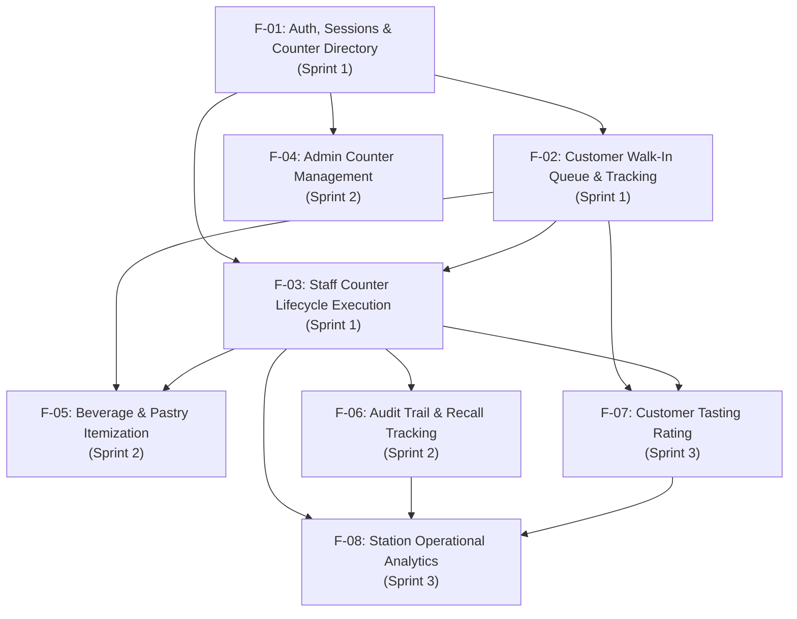

# Feature Inventory

## 1. Feature Catalog Overview

The table below catalogs all features planned across Sprints 1, 2 and 3, mapping each feature to its unique identifier, functional scope, linked requirements, technical dependencies and target delivery sprint.

| Feature ID | Feature Name | Description & Functional Scope | Linked Requirements | Dependencies | Target Sprint |
| :---: | :--- | :--- | :--- | :---: | :---: |
| **`F-01`** | **Authentication, Sessions & Service Counter Directory** | Email/password login with salted bcrypt hashing, PostgreSQL-backed session persistence (`connect-pg-simple`), `/api/auth/me` current user profile endpoint, `/api/auth/logout`, backend Role-Based Access Control (RBAC) middleware and read-only directory of service counters (`SLOW_BAR`, `ESPRESSO_BAR`, `DESSERT_LOUNGE`, `ROASTERY_CONSULT`) indicating open/paused intake state. | `FR-01`, `FR-02`, `BR-02`, `NFR-01`, `NFR-02`, `NFR-03`, `NFR-04` | None | **Sprint 1** |
| **`F-02`** | **Customer Walk-In Queue Joining & Tracking** | Walk-in customer portal allowing authenticated guests to select an open service category, specify party size (`1-8`) and add optional requests (`<= 280` chars). Issues a monotonically sequenced ticket code (e.g., `SB-001`), computes real-time `aheadCount`, displays live status (`WAITING`, `CALLED`, `SERVING`, etc.) and enables customer self-cancellation for `WAITING` tickets with a mandatory reason. | `FR-03`, `FR-04`, `FR-05`, `BR-01`, `BR-02`, `BR-03`, `BR-05`, `BR-06`, `BR-07`, `BR-09`, `NFR-03`, `NFR-05`, `NFR-06` | `F-01` | **Sprint 1** |
| **`F-03`** | **Staff Counter Console & Service Lifecycle Execution** | Barista and Station Manager operational dashboard to view the queue of the staff member's assigned counters (Admin: every counter) filtered by category and status, and to call the next waiting guest, chosen by the server (oldest first). Implements the complete state machine (`WAITING -> CALLED -> SERVING -> COMPLETED / NO_SHOW / CANCELLED`) with mandatory completion summaries, no-show notes, timestamps, counter attribution and backend ownership/role enforcement. | `FR-06`, `FR-07`, `BR-04`, `BR-05`, `BR-06`, `BR-09`, `BR-10`, `NFR-03`, `NFR-05`, `NFR-06` | `F-01`, `F-02` | **Sprint 1** |
| **`F-04`** | **Admin Service Counter Management & Queue Pause/Resume** | Administrative control panel allowing the Station Manager (`ADMIN`) to create new service counters, modify estimated preparation times, update category descriptions and toggle the `is_open` flag to dynamically pause or resume walk-in queue intake during peak rushes, and assign staff to counters (`staff_counters`). | `FR-08`, `BR-02`, `BR-09` | `F-01` | **Sprint 2** |
| **`F-05`** | **Highland Beverage & Pastry Itemization on Tickets** | Ability for staff and guests to attach Omkoi signature beverage and pastry items (e.g., *Doi Mon Chong Mist*, *Omkoi Dirty*, *Khao Puk Nga Mochi Roll*) and customized brewing/temperature preferences to an active queue ticket, generating a service itemization summary. | `FR-09`, `BR-04` | `F-02`, `F-03` | **Sprint 2** |
| **`F-06`** | **Immutable Ticket Audit Trail & Barista Recall Tracking** | Read view (`GET /api/tickets/:id/events`) of the audit history in `ticket_events`, which is written for every status change from Sprint 1, with actor ID, timestamp, from-status, to-status and transition notes. Includes a barista "Recall Customer" tracking mechanism recording timestamps when an absent customer is re-called before marking `NO_SHOW`. | `FR-09`, `BR-04`, `BR-05` | `F-03` | **Sprint 2** |
| **`F-07`** | **Customer Post-Service Tasting Rating & Review** | Closed-loop customer feedback allowing guests to rate their coffee/dessert experience (1 to 5 stars) and write tasting notes on their own ticket once in `COMPLETED` status. Enforces single-submission integrity. | `FR-10`, `BR-08` | `F-02`, `F-03` | **Sprint 3** |
| **`F-08`** | **Station Operational Analytics & Wait-Time Dashboard** | Visual management dashboard displaying key operational performance metrics: total tickets by counter, average waiting duration (`called_at - created_at`), average service duration (`completed_at - serving_started_at`), no-show percentages and hourly throughput. | `FR-10`, `NFR-05` | `F-03`, `F-06`, `F-07` | **Sprint 3** |

---

## 2. Feature Dependency Graph

