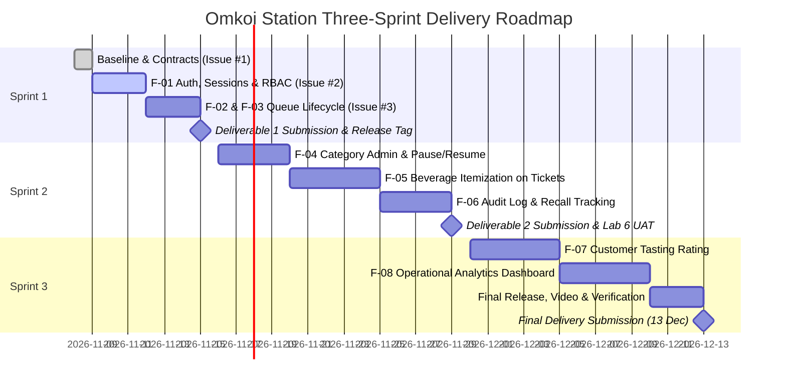

# Three-Sprint Project Plan

## 1. Plan Overview

The system of **Omkoi Station** Cafe Queue and Services Management is structured across three iterative sprints. Each sprint establishes a distinct operational milestone with strict engineering contracts, test suites and deliverables.

---

## 2. Granular Sprint Breakdown

### Sprint 1: Core Domain Slice & Engineering Baseline
- **Milestone Deadline:** Sunday, 15 November 2026, 23:59
- **Target Deliverable:** Project Deliverable 1
- **Sprint Goal:** Deliver a working, tested, database-backed vertical slice of the Omkoi Station queue lifecycle with session authentication, backend-enforced RBAC and responsive web consoles.
- **Included Features:**
  - **`F-01`:** Authentication, PostgreSQL Session Persistence (`connect-pg-simple`), RBAC Middleware and Read-Only Service Category Directory.
  - **`F-02`:** Customer Walk-In Queue Joining (`partySize` 1-8), Sequential Code Issuance (`SB-001`), Live `aheadCount` Tracking and Customer Self-Cancellation (`WAITING` only).
  - **`F-03`:** Barista Counter Operational Console and Lifecycle Execution (`WAITING -> CALLED -> SERVING -> COMPLETED / NO_SHOW / CANCELLED`) with mandatory summaries.
- **Dependencies:** Initial project scaffolding, PostgreSQL 16 schema migrations and idempotent seed script.
- **Completion Outcome & Evidence:**
  - Verified against Acceptance Criteria `AC-01` through `AC-12` and test suite `TEST-01` through `TEST-14`.
  - Captioned program demonstration screenshots covering normal domain journey, business-rule `409` rejection and `403` forbidden RBAC rejection.
  - Two reviewed PRs merged into `staging` and promoted to `main` with release tag `v1.0.0-sprint1`.

---

### Sprint 2: Operational Expansion & Menu Itemization
- **Milestone Deadline:** Sunday, 29 November 2026, 23:59
- **Target Deliverables:** Project Deliverable 2
- **Sprint Goal:** Enable dynamic service counter administration, attach Omkoi signature beverage/dessert items to tickets and record an immutable transition audit trail for cross-team user acceptance testing.
- **Included Features:**
  - **`F-04`:** Admin Service Counter Management (Admin CRUD on service categories, editing preparation durations and toggling `is_open` to pause or resume intake).
  - **`F-05`:** Highland Beverage & Pastry Itemization on Tickets (Attaching menu items, temperature/roast preferences and generating ticket itemization summaries).
  - **`F-06`:** Immutable Ticket Audit Trail (`ticket_events`) and Barista Customer Recall Tracking (Timestamping multiple call attempts before marking `NO_SHOW`).
- **Dependencies:** Sprint 1 core ticket state machine and database models.
- **Completion Outcome & Evidence:**
  - Full Admin category control verified with non-admin rejection (`403`).
  - Itemized tickets verified in UI and database.
  - Defect management logs and bug fixes from Lab 6 Cross-Team UAT incorporated into `docs/sprints/sprint-2/`.

---

### Sprint 3: Customer Feedback, Operational Analytics & Product Hardening
- **Milestone Deadline:** Sunday, 13 December 2026, 23:59
- **Target Deliverables:** Final Project Delivery
- **Sprint Goal:** Complete closed-loop customer tasting feedback, provide station managers with operational analytics, resolve all technical debt and package the final release.
- **Included Features:**
  - **`F-07`:** Customer Post-Service Tasting Rating & Review (1 to 5 stars + tasting comment on own `COMPLETED` tickets, single-submission rule `BR-08`).
  - **`F-08`:** Station Operational Analytics Dashboard (Visual metrics for average wait times, barista service durations, counter volume distribution and no-show rates).
  - **Product Hardening:** Final performance optimization, comprehensive E2E regression suite, responsive UI touch-up and accessibility polish.
- **Dependencies:** Sprint 2 audit events and completed tickets.
- **Completion Outcome & Evidence:**
  - Final verified release tagged on `main`.
  - 4-minute demonstration video highlighting the 4-zone hospitality concept, complete domain journeys and production reliability.