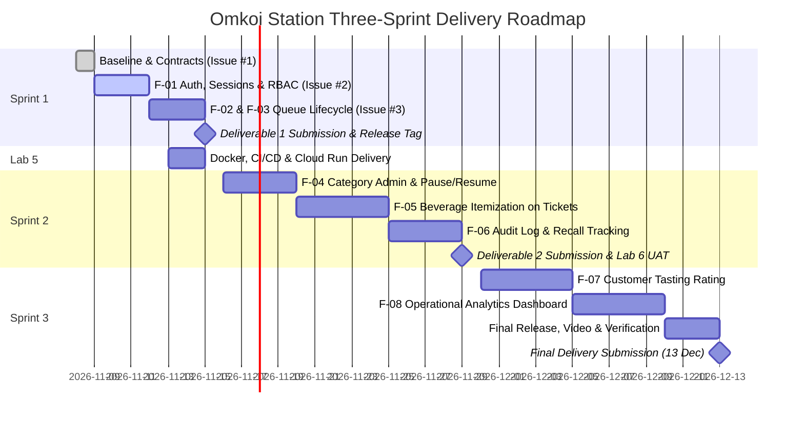

# Three-Sprint Project Plan

## 1. Plan Overview

The system of **Omkoi Station** Cafe Queue and Services Management is structured across three iterative sprints. Each sprint establishes a distinct operational milestone with strict engineering contracts, test suites and deliverables.

---

## 2. Granular Sprint Breakdown

### Sprint 1: Core Domain Slice & Engineering Baseline
- **Milestone Deadline:** Sunday, 15 November 2026, 23:59
- **Target Deliverable:** Project Deliverable 1
- **Sprint Goal:** Deliver a working, tested, database-backed vertical slice of the Omkoi Station queue lifecycle with session authentication, backend-enforced RBAC and responsive web consoles.
- **Included Features:**
  - **`F-01`:** Authentication, PostgreSQL Session Persistence (`connect-pg-simple`), RBAC Middleware and Read-Only Service Category Directory.
  - **`F-02`:** Customer Walk-In Queue Joining (`partySize` 1-8), Sequential Code Issuance (`SB-001`), Live `aheadCount` Tracking and Customer Self-Cancellation (`WAITING` only).
  - **`F-03`:** Barista Counter Operational Console scoped to assigned counters, server-side **Call next** (oldest first) and Lifecycle Execution (`WAITING -> CALLED -> SERVING -> COMPLETED / NO_SHOW / CANCELLED`) with mandatory summaries.
- **Dependencies:** Initial project scaffolding, PostgreSQL 16 schema migrations (`001`-`003`) and idempotent seed script; `F-02` and `F-03` depend on `F-01` sessions and roles, and `F-03` on tickets from `F-02`.
- **Why this scope:** It is the smallest slice that meets every Deliverable 1 requirement and the Theme 9 Sprint 1 example: real login/logout and current-user identity (`F-01`), a customer journey with unique numbering, duplicate prevention and a paused-counter rule (`F-02`), and an operator who calls the next eligible entry on authorized queues only and moves it through a validated state machine (`F-03`). Counter administration, items, audit views, ratings and analytics extend this slice without changing its rules, so they wait for Sprints 2 and 3.
- **Completion Outcome & Evidence:**
  - Verified against Acceptance Criteria `AC-01` through `AC-16` and test suite `TEST-01` through `TEST-20` (including the end-to-end journey `TEST-19`), run on the release commit.
  - Captioned program demonstration screenshots covering normal domain journey, business-rule `409` rejection and `403` forbidden RBAC rejection.
  - Two reviewed PRs merged into `staging` and promoted to `main` with release tag `v1.0.0-sprint1`.

---

### Lab 5: Containerised Delivery (Docker, CI/CD, GCP)
- **Milestone Deadline:** Lab 5 checkpoint (15 November 2026 per the team schedule)
- **Goal:** Package the Sprint 1 release and deliver it to Google Cloud without changing its behaviour.
- **Work Items (system responsibilities, no new FR):** multi-stage `Dockerfile` and local `docker compose` with PostgreSQL 16; a CI workflow that runs migrations, seed and the full test suite on every PR and blocks merging on failure; a deploy pipeline to Cloud Run with Cloud SQL and Secret Manager; a post-deploy smoke test of `/api/health` and `/api/ready`.
- **Dependencies:** Sprint 1 release on `main`; `NFR-02` environment configuration.
- **Completion Outcome & Evidence:** The container passes the same tests as local; `NFR-03` verified across a container restart; `NFR-04` measured against the deployed URL.

---

### Sprint 2: Operational Expansion & Menu Itemization
- **Milestone Deadline:** Sunday, 29 November 2026, 23:59
- **Target Deliverables:** Project Deliverable 2
- **Sprint Goal:** Enable dynamic service counter administration, attach Omkoi signature beverage/dessert items to tickets and record an immutable transition audit trail for cross-team user acceptance testing.
- **Included Features:**
  - **`F-04`:** Admin Service Counter Management (Admin CRUD on service categories, editing preparation durations, toggling `is_open` to pause or resume intake, and assigning staff to counters).
  - **`F-05`:** Highland Beverage & Pastry Itemization on Tickets (Attaching menu items, temperature/roast preferences and generating ticket itemization summaries).
  - **`F-06`:** Ticket Audit Trail View (`GET /api/tickets/:id/events` over the `ticket_events` rows written since Sprint 1) and Barista Customer Recall Tracking (Timestamping multiple call attempts before marking `NO_SHOW`).
- **Dependencies:** Sprint 1 core ticket state machine and database models.
- **Completion Outcome & Evidence:**
  - Full Admin category control verified with non-admin rejection (`403`).
  - Itemized tickets verified in UI and database.
  - Defect management logs and bug fixes from Lab 6 Cross-Team UAT incorporated into `docs/sprints/sprint-2/`.

---

### Sprint 3: Customer Feedback, Operational Analytics & Product Hardening
- **Milestone Deadline:** Sunday, 13 December 2026, 23:59
- **Target Deliverables:** Final Project Delivery
- **Sprint Goal:** Complete closed-loop customer tasting feedback, provide station managers with operational analytics, resolve all technical debt and package the final release.
- **Included Features:**
  - **`F-07`:** Customer Post-Service Tasting Rating & Review (1 to 5 stars + tasting comment on own `COMPLETED` tickets, single-submission rule `BR-08`).
  - **`F-08`:** Station Operational Analytics Dashboard (Visual metrics for average wait times, barista service durations, counter volume distribution and no-show rates).
  - **Product Hardening:** Final performance optimization, comprehensive E2E regression suite, responsive UI touch-up and accessibility polish.
- **Dependencies:** Sprint 2 audit events and completed tickets.
- **Completion Outcome & Evidence:**
  - Final verified release tagged on `main`.
  - 4-minute demonstration video highlighting the 4-zone hospitality concept, complete domain journeys and production reliability.

---

## 3. Risks & Mitigations

| Risk | Likelihood / Impact | Mitigation |
| :--- | :--- | :--- |
| Sprint 1 and Lab 5 share the same week, leaving little time for both. | High / High | Keep Sprint 1 to `F-01`-`F-03`; write tests with the contract; start the `Dockerfile` as soon as `F-01` runs. |
| Concurrency bugs in joining or call-next (duplicate codes or tickets). | Medium / High | Database-level locking and the partial unique index (SDS 2.2); `TEST-18` runs parallel requests against real PostgreSQL. |
| Authorization implemented only in the UI. | Medium / High | Every permission has an API test (`TEST-09`, `TEST-16`); the DoD requires backend enforcement. |
| Tests depending on leftover database state. | Medium / Medium | Each suite resets its tables and sets its own fixture state; the seed is idempotent. |
| One member becomes a bottleneck for reviews. | Medium / Medium | Small PRs per feature; the other member reviews within a day; pair on `F-03`. |
| Deadline ambiguity (handout 8 Nov vs team plan 15 Nov). | Low / High | Tracked as `Q-05` in the SRS; confirm on LEB2 before submission. |
