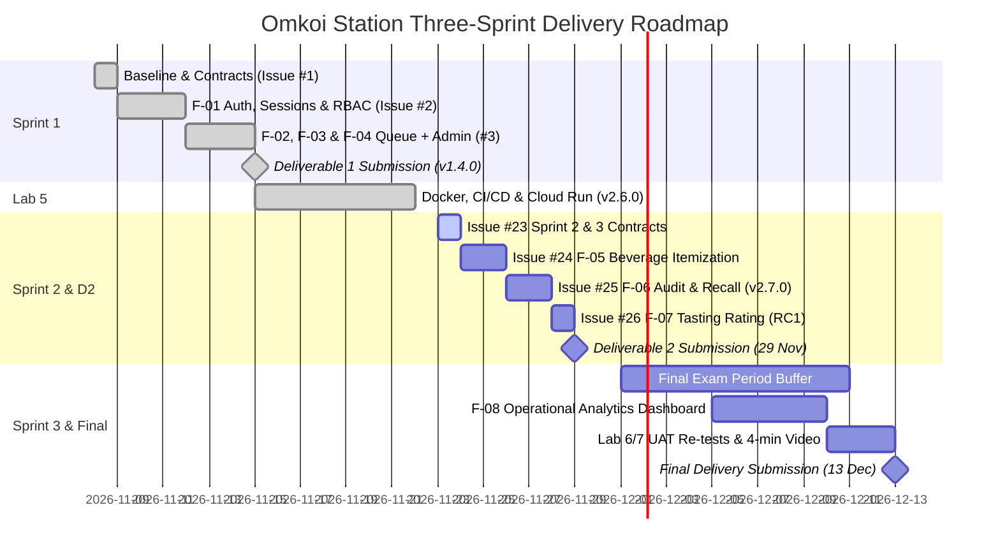

# Three-Sprint Project Plan

## 1. Plan Overview

The system of **Omkoi Station** Cafe Queue and Services Management is structured across three iterative sprints. Each sprint establishes a distinct operational milestone with strict engineering contracts, test suites and deliverables.

---

## 2. Granular Sprint Breakdown

### Sprint 1: Core Domain Slice & Engineering Baseline
- **Milestone Deadline:** Sunday, 15 November 2026, 23:59
- **Target Deliverable:** Project Deliverable 1
- **Sprint Goal:** Deliver a working, tested, database-backed vertical slice of the Omkoi Station queue lifecycle with session authentication, backend-enforced RBAC and responsive web consoles.
- **Included Features:**
  - **`F-01`:** Authentication, PostgreSQL Session Persistence (`connect-pg-simple`), RBAC Middleware and Read-Only Service Category Directory.
  - **`F-02`:** Customer Walk-In Queue Joining (`partySize` 1-8), Sequential Code Issuance (`SB-001`), Live `aheadCount` Tracking and Customer Self-Cancellation (`WAITING` only).
  - **`F-03`:** Barista Counter Operational Console scoped to assigned counters, server-side **Call next** (oldest first) and Lifecycle Execution (`WAITING -> CALLED -> SERVING -> COMPLETED / NO_SHOW / CANCELLED`) with mandatory summaries.
  - **`F-04`:** Admin Service Counter Management (create and edit counters, pause or resume intake, assign staff), moved from Sprint 2 (`C-18`).
- **Delivery:** three PRs into `staging`: Issue #1 baseline (PR #4), Issue #2 `F-01` (PR #5), Issue #3 `F-02` + `F-03` + `F-04` (PR #6); then the release PR `staging -> main`.
- **Dependencies:** Initial project scaffolding, PostgreSQL 16 schema migrations (`001`-`003`) and idempotent seed script; `F-02` and `F-03` depend on `F-01` sessions and roles, `F-03` on tickets from `F-02`, and `F-04` on `F-01` and the `staff_counters` table of `F-03`.
- **Why this scope:** It is the smallest slice that meets every Deliverable 1 requirement and the Theme 9 Sprint 1 example: real login/logout and current-user identity (`F-01`), a customer journey with unique numbering, duplicate prevention and a paused-counter rule (`F-02`), and an operator who calls the next eligible entry on authorized queues only and moves it through a validated state machine (`F-03`). Counter administration (`F-04`) was pulled in because it reuses tables Sprint 1 already has and lets the release demonstrate pausing (`BR-02`) and staff scope (`BR-09`) from the UI. Items, audit views, ratings and analytics extend this slice without changing its rules, so they wait for Sprints 2 and 3.
- **Completion Outcome & Evidence:**
  - Verified against Acceptance Criteria `AC-01` through `AC-20` and test suite `TEST-01` through `TEST-25` (including the end-to-end journey `TEST-19`), run on the release commit.
  - Captioned program demonstration screenshots covering normal domain journey, business-rule `409` rejection and `403` forbidden RBAC rejection.
  - Three reviewed PRs merged into `staging` and promoted to `main` with release tag `v1.0.0-sprint1`.

---

### Lab 5: Containerised Delivery (Docker, CI/CD, GCP)
- **Milestone Deadline:** Lab 5 checkpoint (15 November 2026 per the team schedule)
- **Goal:** Package the Sprint 1 release and deliver it to Google Cloud without changing its behaviour.
- **Work Items (system responsibilities, no new FR):** multi-stage `Dockerfile` and local `docker compose` with PostgreSQL 16; a CI workflow that runs migrations, seed and the full test suite on every PR and blocks merging on failure; a deploy pipeline to Cloud Run with Cloud SQL and Secret Manager; a post-deploy smoke test of `/api/health` and `/api/ready`.
- **Dependencies:** Sprint 1 release on `main`; `NFR-02` environment configuration.
- **Completion Outcome & Evidence:** The container passes the same tests as local; `NFR-03` verified across a container restart; `NFR-04` measured against the deployed URL.

---

### Sprint 2: Operational Expansion & Menu Itemization
- **Milestone Deadline:** Sunday, 29 November 2026, 23:59
- **Target Deliverables:** Project Deliverable 2 (`v2.7.0` Sprint 2 release on `main`, followed by `v3.0.0-rc1` with `F-07` Sprint 3 progress)
- **Sprint Goal:** Attach Omkoi signature beverage/dessert items to tickets and expose the immutable transition audit trail + barista recall tracking (`F-05`, `F-06`), contract all Sprint 3 features (`F-07`, `F-08`), and deliver tested Sprint 3 progress (`F-07`) integrated on Cloud Run.
- **Delivery Issues:**
  - **Issue `#23` (Contracts & Plan Baseline, `docs/23-sprint2-sprint3-contracts`):** Complete contracts, AC (`AC-21`–`AC-33`), and STS (`TEST-26`–`TEST-38`) for `F-05`–`F-08` plus updated SRS/SDS/Traceability before any runtime code (`staging` only, leaving `main` at `v2.6.0` during Lab 6 UAT).
  - **Issue `#24` (`F-05`):** Highland Beverage & Pastry Itemization (`004_ticket_items.sql`, `GET /api/menu`, `/items`, `BR-13`, TDD `TEST-26`–`TEST-29`).
  - **Issue `#25` (`F-06`):** Immutable Ticket Audit Trail & Barista Recall Tracking (`005_ticket_recall.sql`, `GET /events`, `POST /recall`, `BR-14`, TDD `TEST-30`–`TEST-33`) → Sprint 2 Release **`v2.7.0`**.
- **Dependencies:** Sprint 1 core ticket state machine and database models (`v1.4.0` / `v2.6.0`).
- **Completion Outcome & Evidence:**
  - Itemized tickets, audit events, and recall tracking verified in UI, API, and Cloud SQL PostgreSQL 16.
  - Defect management logs and bug fixes from Lab 6 Cross-Team UAT incorporated into the change/defect register (`docs/traceability.md` §5).

---

### Sprint 3: Customer Feedback, Operational Analytics & Product Hardening
- **Checkpoint Deliverable 2 Progress (by 29 November 2026):**
  - **Issue `#26` (`F-07`):** Customer Post-Service Tasting Rating & Review (`006_ticket_feedback.sql`, `BR-08`, `POST/GET /api/tickets/:id/feedback`, TDD `TEST-34`–`TEST-36`) integrated with Sprints 1 & 2 and deployed to Cloud Run as **`v3.0.0-rc1`**.
- **Milestone Deadline (Final Delivery):** Sunday, 13 December 2026, 23:59 *(planned around the 1–11 December final examination period)*
- **Target Deliverables:** Final Project Delivery
- **Sprint Goal:** Deliver station-wide operational analytics (`F-08`), complete Lab 6/7 UAT fixes and re-tests, run full end-to-end verification, and submit the final release and 4-minute video.
- **Remaining Bounded Completion Plan (30 Nov – 13 Dec):**
  - **`F-08` (3–8 Dec):** Station Operational Analytics Dashboard (`GET /api/analytics/summary`, `/analytics`, `TEST-37`–`TEST-38`, zero new migrations).
  - **Hardening & Re-tests (8–12 Dec):** Resolve any remaining Lab 6/Lab 7 defects, run full regression & responsive E2E suite on the final release tag.
  - **Final Packaging (12–13 Dec):** Record 4-minute demo video covering the 4-zone hospitality concept, live domain journeys, and Cloud Run reliability.

---

## 3. Risks & Mitigations

| Risk | Likelihood / Impact | Mitigation |
| :--- | :--- | :--- |
| Sprint 1 and Lab 5 share the same week, leaving little time for both. | High / High | Keep Sprint 1 to `F-01`-`F-03`; write tests with the contract; start the `Dockerfile` as soon as `F-01` runs. |
| Concurrency bugs in joining or call-next (duplicate codes or tickets). | Medium / High | Database-level locking and the partial unique index (SDS 2.2); `TEST-18` runs parallel requests against real PostgreSQL. |
| Authorization implemented only in the UI. | Medium / High | Every permission has an API test (`TEST-09`, `TEST-16`); the DoD requires backend enforcement. |
| Tests depending on leftover database state. | Medium / Medium | Each suite resets its tables and sets its own fixture state; the seed is idempotent. |
| One member becomes a bottleneck for reviews. | Medium / Medium | Small PRs per feature; the other member reviews within a day; pair on `F-03`. |
| Deadline ambiguity (handout 8 Nov vs team plan 15 Nov). | Low / High | Tracked as `Q-05` in the SRS; confirm on LEB2 before submission. |
